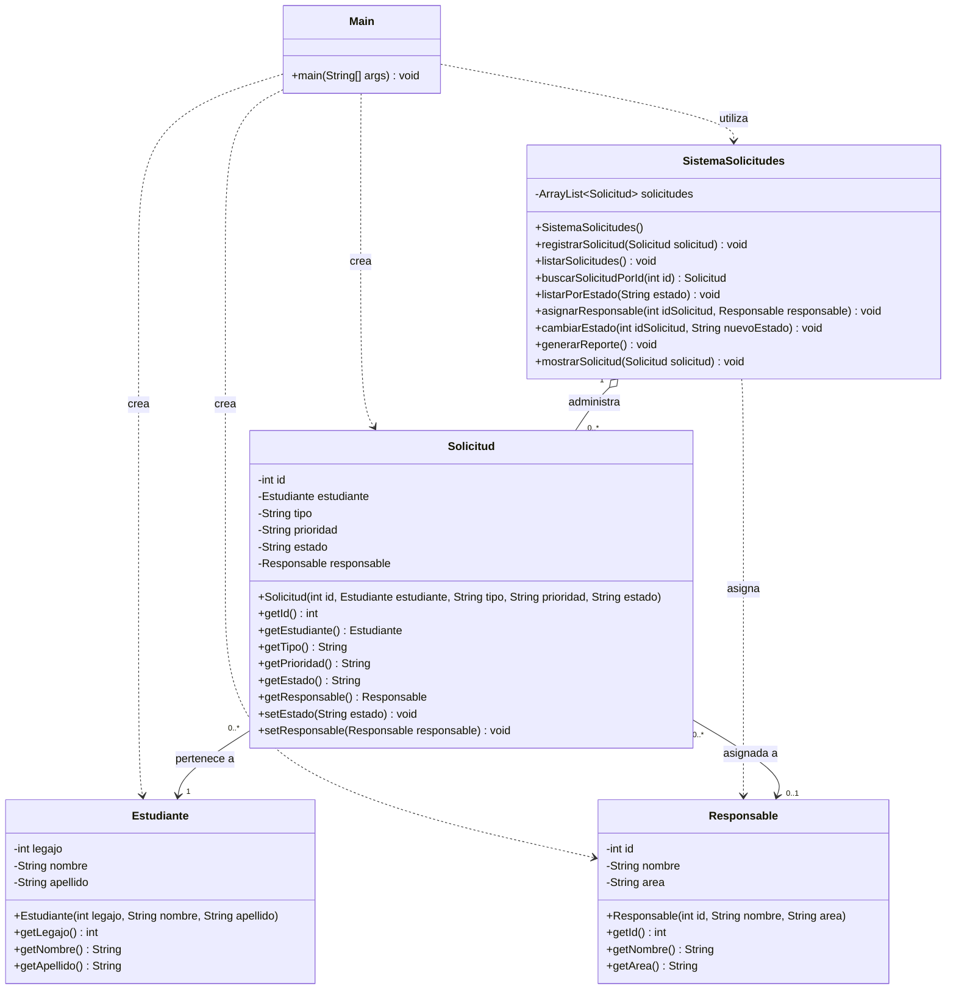

# Diagrama UML de clases — Estado inicial del SGSA

Este diagrama representa la estructura original del Sistema de Gestión
de Solicitudes Académicas (SGSA), antes de aplicar refactoring.

Se incluyen las cinco clases Java, sus atributos, métodos y relaciones.

