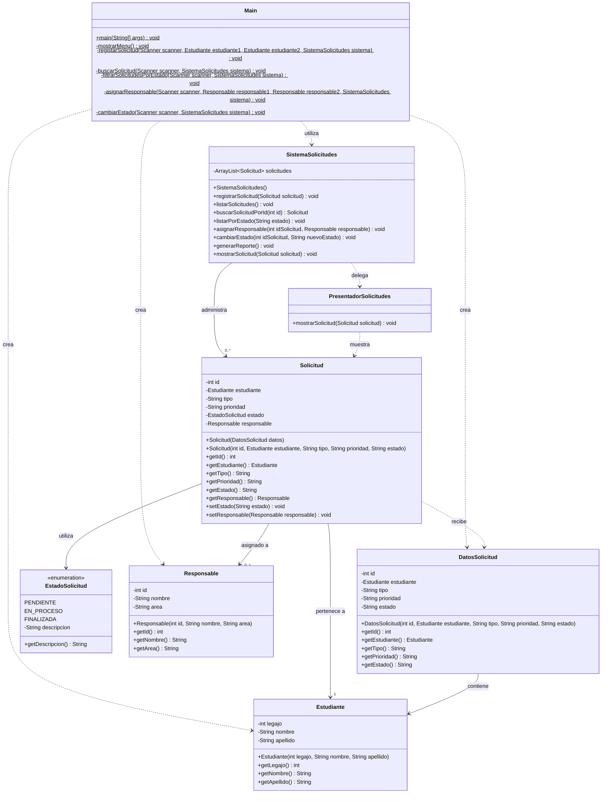

# Diagrama UML de clases — Estado refactorizado del SGSA

Este diagrama representa la estructura final del Sistema de Gestión de Solicitudes Académicas (SGSA), después de aplicar los cuatro refactorings.

Se incluyen las ocho clases Java, sus atributos, métodos y relaciones, reflejando las mejoras realizadas en la organización y mantenibilidad del código.

